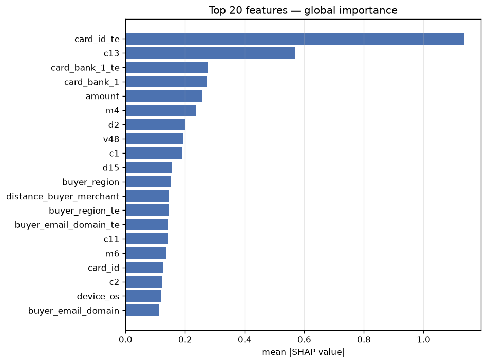
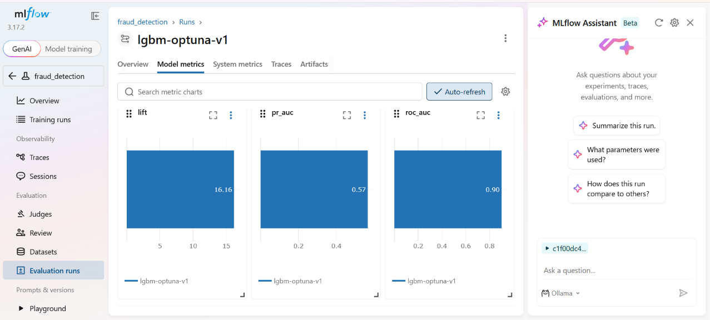
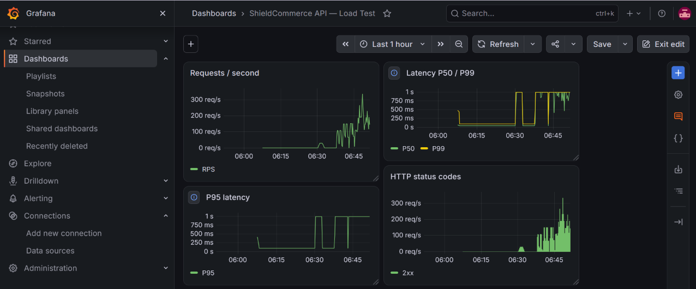

# ShieldCommerce AI
> **Real-time fraud detection platform with agentic investigation**

[](https://github.com/ngahyves/Shield-Commerce-AI/actions/workflows/ci.yaml)


## 1-Overview

**The problem.** E-commerce fraud costs merchants billions annually. A production system must flag suspicious transactions in under 100 ms (the payment authorization deadline), avoid blocking legitimate customers (asymmetric cost of false positives), and explain every decision to human analysts for audit and compliance.

**The data.** Built on the IEEE-CIS Fraud Detection dataset from Vesta's Kaggle competition(https://www.kaggle.com/competitions/ieee-fraud-detection): 590,540 transactions over 182 days, with a 3.50% fraud rate and documented temporal drift (fraud rate ×1.98 between early and late periods).

**The system.** An end-to-end fraud detection platform covering the full ML lifecycle:

- **Offline (Databricks)**: Medallion architecture (Bronze → Silver → Gold), 119 engineered features, LightGBM tuned with Optuna
- **Online (FastAPI)**: Real-time scoring (`/predict`, 41 ms) + agentic investigation (`/explain`) that explains each decision with SHAP factors, customer history, and similar frauds from Qdrant
- **Infrastructure**: Docker Compose (local), Kubernetes (production), GitHub Actions (CI)

**Key results:**
- **PR-AUC: 0.5786, ROC_AUC: 0.91** on strict temporal holdout — **16.5× lift** vs random
- **Latency (single request)**: 41 ms P50 per `/predict` — compatible with real-time authorization
- **Latency (under load)**: 1 100 ms P50 at 2 replicas under 100 concurrent users — linear K8s scaling (P50 ÷2 vs 1 replica at 2 200 ms)
- **94% agent faithfulness** — 10 narratives judged, 0 hallucination hotspots

## 2-End-to-end architecture	ASCII : Bronze → Gold → API → Agent

```text
┌─────────────────── PHASE 1 — OFFLINE (Databricks) ─────────────────────┐
│                                                                        │
│  Bronze: raw Vesta — 434 features (399 num + 37 cat + target + ID)     │
│  590,540 rows, 182 days                                                │
│         │                                                              │
│         ├── 02 Data profiling                                          │
│         │    missing values, fraud rate 3.50%, temporal drift ×1.98    │
│         │                                                              │
│         ├── 03 Silver — Pandera validation, dtype casting              │
│         │                                                              │
│         └── 04 EDA                                                     │
│              Numeric:     Mann-Whitney U + rank-biserial               │
│              Categorical: Chi² + Cramér's V                            │
│                                                                        │
│  ▼ Feature selection (05) — 434 → 119 features                         │
│      Numeric:     399 → 232  (|r_rb| > 0.10)                           │
│      Categorical:  37 →  22  (Chi² + Cramér's V)                       │
│      Redundancy:  1,104 pairs (|r| > 0.85) → 29 NetworkX components    │
│                   largest: [44, 28, 16, 12, 11, 10, 6, 6, 5, 4]       │
│                   42 isolated features (no pair > 0.85)                │
│      Pruning:     keep 1 per component (highest |r_rb|)                │
│                                                                        │
│  ▼ Feature engineering (05)                                            │
│      Velocity:      counts + amounts (1h / 24h / 7d)                   │
│      UserID:        composite (card + addr + email)                    │
│      Derived time:  hour, day_of_week, is_weekend                      │
│      is_null flags, column renames                                     │
│      Target encoding: 7 categoricals → +7 TE cols                      │
│                                                                        │
│  ▼ Modeling (06)                                                       │
│      Walk-forward: 2 variants (gap 21d, 3-fold sliding window)         │
│      4 model configs compared:                                         │
│         M1 Silver+LightGBM  M2 Gold+LightGBM                          │
│         M3 Silver+engineered  M4 (winner) Gold 119 + 7 TE              │
│      Optuna: 25 trials, 40 min timeout, objective = PR-AUC             │
│         → reg_alpha ×7.6, reg_lambda ×17M (anti-drift)                 │
│      Top SHAP: card_id_te, c13, card_bank_1, amount                    │
│      Platt calibration: Brier 0.029 → 0.023                            │
│                                                                        │
│  Export → classifier.pkl, target_encoder.pkl, calibrator.pkl,          │
│           gold_export.parquet                                          │
└────────────────────────────────┬───────────────────────────────────────┘
                                 │
                                 ▼
┌─────────────────── PHASE 2 — ONLINE (FastAPI + K8s) ───────────────────┐
│                                                                        │
│  Client ─► POST /predict ─► LightGBM + Calibrator ─► decision          │
│                                                     │                  │
│                            ┌────────────────────────┴───────┐          │
│                            │                                │          │
│                     approve / block                    review          │
│                     fast path (no LLM)                 agent           │
│                            │                                │          │
│                            │              LangGraph: retrieval         │
│                            │              ├─ SHAP top-5                │
│                            │              ├─ Qdrant similar            │
│                            │              ├─ Customer (Redis cache)    │
│                            │              └─ Related transactions      │
│                            │                                │          │
│                            │              investigator → reporter     │
│                            │              LLM: Groq (fallback Gemini)  │
│                            ▼                                ▼          │
│                     JSON decision              InvestigationReport     │
│                                                + evidence + reasoning │
└────────────────────────────────────────────────────────────────────────┘
```

## 3. Phase 1 — R&D & Feature Engineering (Databricks)

Six Jupyter notebooks cover the **R&D phase**: data exploration, feature
selection, model comparison, and hyperparameter tuning. The validated
strategy (126 features, LightGBM, Optuna hyperparameters) is then
**re-implemented as production code in VS Code** (Section 5) — a standard
pattern: notebooks for exploration, Python modules for production.

### The ML challenge

IEEE-CIS Fraud Detection presents three structural difficulties:

1. **High dimensionality** — 434 raw features (399 numeric + 37 categorical)
   with many redundant pairs
2. **Severe class imbalance** — 3.50% fraud rate → `scale_pos_weight = 27.6`
3. **Temporal drift** — fraud rate ×1.98 between the first and last 60-day
   windows; a random KFold overestimates performance by ~20 PR-AUC points

The pipeline addresses each: statistical feature selection for dimensionality,
`scale_pos_weight` for imbalance, and walk-forward validation for drift.

### 01 — Bronze ingestion

Load Vesta raw CSVs (`train_transaction.csv` + `train_identity.csv`) into
Delta tables, union into a single Bronze table: **590,540 rows × 434 columns**.

### 02 — Data profiling

- Missing-value map per column (>50% null in many Vesta features)
- Fraud rate over time — reveals the ×1.98 drift
- Class balance: 3.50% fraud / 96.50% legitimate
- Cardinality: `card_id` has 13,500+ unique values

### 03 — Silver transformation

Pandera validation (`coerce=False` — detect, not fix), dtype downcast
(`float64 → float32`), column renames for readability.

### 04 — EDA

**Numeric features** — Mann-Whitney U test + rank-biserial correlation:
- 399 numeric → **232 retained** with `|r_rb| > 0.10`

**Categorical features** — Chi² test + Cramér's V:
- 37 categorical → **22 retained** with `Cramér's V > 0.05`

### 05 — Gold feature engineering

**Redundancy elimination.** Among the 254 survivors, **1,104 pairs** exceed
`|r| > 0.85`. Modeled as a graph with NetworkX:

- 29 connected components
- Largest: `[44, 28, 16, 12, 11, 10, 6, 6, 5, 4]` features
- 42 isolated features (no redundant pair)

**Pruning rule** — keep exactly 1 feature per component, chosen as the one
with the highest `|rank-biserial|`. Full component → kept-feature mapping
in `05_gold_feature_engineering.ipynb`.

**Engineering new features:**
- **Velocity** — counts + amount sums over 1h / 24h / 7d windows
- **UserID** — composite key `(card_id, addr1, email_domain)`
- **Time features** — `hour_of_day`, `day_of_week`, `is_weekend`
- **`is_null_*` flags** for missing Vesta features
- **Target encoding** — 7 categoricals (`buyer_region`,
  `buyer_email_domain`, `device_os`, `browser`, `card_id`, `card_bank_1`,
  `screen_resolution`) with `TargetEncoder(smoothing=20, cv=5)`

**Output:** 119 selected features + 7 target-encoded = **126 features**.

### 06 — Baseline modeling

#### Walk-forward validation — training window selection

Three non-overlapping 31-day validation periods tested. For each period,
train on the N days immediately preceding (no gap — production simulation).
Target encoding refitted inside each fold to prevent cross-fold leakage.

| Window | P1 (days 61-91) | P2 (92-122) | P3 (123-153) | **Mean** | **Std** |
|---|---|---|---|---|---|
| W30 | 0.6319 | 0.5352 | 0.5738 | 0.5803 | 0.0487 |
| **W60** | 0.6133 | 0.5446 | **0.5849** | **0.5809** | **0.0345** |
| W90 | — | 0.5489 | 0.5718 | 0.5604 | 0.0161 |
| W120 | — | — | 0.5668 | 0.5668 | — |

**W60 retained** — highest mean (0.5809) and lowest variance (std 0.0345).
Longer windows (W90, W120) underperform: too much stale history pulls the
model away from the current fraud regime. W30 is noisier (std 0.0487) despite
similar mean. **The 60-day window is the sweet spot for this dataset.**

*Note:* W90 and W120 cannot be tested on P1/P2 because there are not enough
prior days. This is a dataset constraint, not a design choice.

#### Gap analysis — why no gap?

A 21-day gap was tested as a diagnostic: does dropping the most recent
3 weeks help generalization (by avoiding overfitting to recent noise)?

| Fold | Train | Gap | Valid | PR-AUC |
|---|---|---|---|---|
| Fold 1 | 1-64 | 21d | 85-105 | 0.4705 |
| Fold 2 | 1-85 | 21d | 106-126 | 0.5649 |
| Fold 3 | 1-106 | 21d | 127-153 | 0.4795 |
| **Reference** | 1-126 | **0d** | 127-153 | **0.5655** |

**The gap costs −0.086 PR-AUC** on the matched validation window (0.4795
vs 0.5655). The most recent days contain the fraud-wave signature that the
validation period needs to detect its continuation. **No gap retained.**

#### Model selection — 4 configurations

| Config | Features | PR-AUC | AUC-ROC | Lift |
|---|---|---|---|---|
| M1 — Silver + LightGBM | ~300 | 0.5482 | 0.9154 | 15.96× |
| M2 — Gold 119 + LightGBM | 119 | 0.5375 | 0.9148 | 15.65× |
| M3 — Silver + engineered | ~300 | 0.5438 | 0.9125 | 15.83× |
| **M4 — Gold 119 + 7 TE** | **126** | **0.5786** | **0.9161** | **16.52×** |

**M4 wins by +3 PR-AUC points over the Silver baseline (M1)** and +4 over
selection-only (M2). The target encoding adds substantial signal that
neither raw Silver nor selection alone captures. Engineering without
selection (M3) confirms that feature quality matters more than feature
quantity.

#### Hyperparameter tuning — Optuna

- 25 trials, 40-minute timeout, objective = validation PR-AUC
- Converged to extreme regularization: `reg_alpha ×7.6`, `reg_lambda ×17M`
  vs LightGBM defaults
- **Interpretation**: strong regularization is the anti-drift mechanism.
  The model resists temporal shift by under-fitting to spurious patterns.

#### Top features (SHAP)

Mean |SHAP| ranking on the full test set:

1. `card_id_te` — target-encoded card identity (strongest signal)
2. `c13` — Vesta counter
3. `card_bank_1` — issuing bank
4. `amount` — transaction value

The dominance of `card_id_te` validates the target encoding decision: the
model leans heavily on card-level fraud history.



#### Hand-off to production (VS Code)

Notebook 06 outputs **the validated strategy**, not the production model:

- 126 selected features (119 Gold + 7 target-encoded)
- LightGBM with Optuna hyperparameters (`reg_alpha ×7.6`, `reg_lambda ×17M`)
- Walk-forward configuration (W60 sliding, no gap)

The **Gold table is exported** (`gold_export.parquet`, 590,540 rows) to VS Code.

**Model training, target encoding, and Platt calibration are re-run as
production code in VS Code** (`src/training/trainer.py`,
`src/features/target_encoder.py`, `src/calibration/calibrator.py`). This
keeps the production pipeline under version control with unit tests, and
avoids notebook-to-production drift.

## 4.Phase 2 — Production API & Agent (VS Code)

The validated R&D strategy is re-implemented as production Python modules,
under version control and unit tests. This is where the model becomes a
service.

### Production code structure

| Module | Responsibility |
|---|---|
| `src/training/trainer.py` | Trains LightGBM on the Gold table with the Optuna hyperparameters |
| `src/features/target_encoder.py` | Fits the `TargetEncoder` on 7 categoricals |
| `src/calibration/calibrator.py` | Fits Platt scaling, evaluates Brier |
| `src/agents/` | LangGraph multi-agent pipeline (5 nodes) |
| `app/routes/` | FastAPI endpoints |
| `src/vector/` | Qdrant indexing + similarity search |

**Hyperparameters** from Optuna are copied manually into `config.yaml` —
the single source of truth for production training. `trainer.py` reads
from there, not from notebook constants.

### API endpoints

| Method | Path | Latency | Purpose |
|---|---|---|---|
| POST | `/predict/{tx_id}` | **41 ms P50** | Supervised scoring + decision |
| POST | `/explain/{tx_id}` | 6-10 s (cache: ~50 ms) | Agentic investigation with evidence |
| GET | `/health` | < 10 ms | Liveness probe |
| GET | `/ready` | ~10 ms | Readiness (pickles, Gold, Qdrant, Redis) |
| GET | `/metrics` | ~50 ms | Prometheus scrape |

**`/predict` returns:** `transaction_id`, `raw_score`, `calibrated_proba`,
`decision`, `model_name`, `model_version`, `thresholds`.

**`/explain` returns a 3-layer response:**
- `report` — Pydantic-validated `InvestigationReport` (machine-readable)
- `investigation` — 2500-char free-text analysis (human-readable)
- `evidence_bundle` — structured SHAP factors, customer profile, similar cases (UI-ready)

### Calibration and decision thresholds

**Platt scaling** fitted on days 155-164, evaluated on 165-181:
- Brier score: **0.029 → 0.023** (−21%)
- No PR-AUC degradation → safe to apply

**Cost-optimal thresholds** — two policies, computed from the test set:

| Action | Cost FN | Cost FP | Threshold | Precision | Recall |
|---|---|---|---|---|---|
| **Review** (analyst check) | 10 | 1 | **0.0412** | 36.1% | 65.8% |
| **Block** (auto-refuse) | 3 | 15 | **0.7346** | 91.3% | 22.7% |

#### Two independent cost policies

Each action has its own asymmetric cost model, and its threshold is chosen
to minimize **that action's** total cost over the test set.

**Review — `FN × 10 + FP × 1`**
- A false negative is expensive (10): a fraud slips through undetected — 
  chargeback, lost goods, reputational damage. **Nothing downstream catches it.**
- A false positive is cheap (1): an analyst spends 5-10 minutes checking 
  a transaction that turns out legitimate. Customer experience is preserved.
- → Threshold driven **low** (0.0412). Result: 3,214 transactions flagged 
  out of 75,788, precision 36%, recall **66%**. We accept 2 false alarms 
  per true fraud because a review costs almost nothing and a missed 
  fraud costs everything.

**Block — `FN × 3 + FP × 15`**
- A false positive is catastrophic (15): a legitimate customer is 
  **hard-refused**. Lost sale, angry customer, support escalation, 
  possible regulatory complaint. Worst UX a payment system can deliver.
- A false negative is annoying but recoverable (3): the transaction is 
  still in the review pipeline, where an analyst will catch it.
- → Threshold driven **very high** (0.7346). Result: 439 auto-blocks, 
  precision **91%**, recall 23%. We only block when the model is 
  almost certain.

**Why the two thresholds coexist.** They are not competing — they are 
complementary layers:
- **Block** is the hard-stop layer, reserved for obvious cases.
- **Review** is the catch-all layer, picking up everything block missed 
  plus ambiguous cases.
- A fraud missed by block lands in review (recoverable).
- A fraud missed by review is missed for good.

**Why they are recomputed at every retraining.** The optimal threshold 
depends on the model's calibrated probability distribution, which changes 
when the model is retrained. Hardcoding `0.0412` and `0.7346` would mean 
retraining with stale decisions — the model would improve while the 
thresholds silently become suboptimal. That's why `metadata.json` stores 
the thresholds computed by the evaluator, not `config.yaml`.

**Fast-path coverage.** On the test set, the two fast paths (`approve` 
below 0.0412 and `block` above 0.7346) cover **vast majority of transactions**. 
Only ~3.7% enter the agentic pipeline (`review`), which is exactly where 
the LLM adds value.

### Two-layer decision pipeline
```text
transaction_id
│
▼
┌──────────────────────────┐
│ score_transaction() │ ← 41 ms P50
│ fetch → encode → predict │
│ → calibrate → map │
└────────────┬─────────────┘
│
┌───────────┼──────────────┐
▼           ▼              ▼
approve   block       review
fast path fast path   full investigation
(0 ms)    (0 ms)      (6-10 s, LLM)
```

### The agentic pipeline — LangGraph

#### node state machine:
```text
router_node → retrieval_node → investigator_node → reporter_node
▼                       ▼
LLM: gpt-oss-20b LLM:   gpt-oss-20b
(2500-char analysis)    (structured JSON)
```

**Retrieval tools (deterministic, no LLM):**

| Tool | What it returns |
|---|---|
| `get_transaction` | Raw features from Gold |
| `get_customer(uid, dt)` | Customer aggregates *before* the transaction (anti-leakage) |
| `get_related_transactions` | Last N transactions in a time window |
| `get_shap_explanations` | Top-5 SHAP contributors |
| `search_similar_cases` | 5 confirmed frauds from Qdrant, filtered by time |

**All tools filter `transaction_dt < current`** — mirrors the training-time
temporal split, prevents future-data leakage.

### LLM resilience

**Primary**: Groq `gpt-oss-20b` (free tier: 8 000 TPM)
**Fallback**: Gemini `3.5-flash-lite` (separate quota, 250K TPM)

**Three mitigations for rate limits:**
1. `Semaphore(2)` — max 2 concurrent Groq calls (prevents retry cascades)
2. Automatic fallback on `429` — Gemini absorbs the overflow
3. Non-429 errors are re-raised (fail fast, don't silently retry)


### Caching strategy

**Redis on `/explain` only** — key: `explain:v1:{model_version}:{tx_id}`
- Cache hit: ~50 ms (vs 6-10 s miss)
- TTL: 24 h
- Versioned by model → retraining auto-invalidates stale reports

**`/predict` is not cached** — 41 ms is fast enough, and each transaction
is unique in production.

### Agent evaluation — 2-level assessment

The agent does not decide — the model + thresholds do. The agent *explains*.
So evaluating "recommendation accuracy" would test something that doesn't
exist at this layer.

**Q1 — Retrieval correctness** (deterministic):
- 40 assertions across 10 transactions × 4 checks
- **100% pass rate** — tools return exactly the right data

**Q2 — Hallucination detection** (Gemini judge):
- 5 binary questions per narrative (numbers, customer claims, similar cases,
  recommendation support, internal contradictions)
- **Mean score: 0.06** (94% faithfulness), **0 cases flagged > 0.5**

Full methodology in [`docs/agent_evaluation.md`](docs/agent_evaluation.md).

### Infrastructure — Docker Compose

5 services orchestrated in a single `docker-compose.yaml`:

| Service | Image | Port | Purpose |
|---|---|---|---|
| api | `rickyr7/shieldcommerce-api` | 8002 | FastAPI, 2 workers |
| redis | `redis:7-alpine` | 6380 | `/explain` cache |
| qdrant | `qdrant/qdrant` | 6335 | Vector store, 17,889 frauds |
| prometheus | `prom/prometheus` | 9091 | Metrics scrape |
| grafana | `grafana/grafana` | 3001 | Dashboards |

**One command** brings the full stack up: `docker compose up -d`.

### Kubernetes deployment — horizontal scaling

Deployed on k3d (2 nodes: 1 server + 1 agent, 4 vCPU, 15 GB RAM).
Locust load test: **100 concurrent users, 2 minutes**, endpoint `/predict`.

| Replicas | Requests | Failures | P50 | P95 | **RPS** |
|---|---|---|---|---|---|
| 1 | 3,467 | 0 | 2,200 ms | 2,600 ms | 28.9 |
| 2 | 5,764 | 0 | 1,100 ms | 1,700 ms | **48.0** |
| 4 | 7,675 | 0 | **400 ms** | **1,300 ms** | **64.0** |

**Linear scaling up to 2 replicas** — P50 halved exactly (÷2.00) when
doubling pods. At 4 replicas, the bottleneck shifts from the API to the
Locust load generator (~70 req/s max with 100 users).

**0% failures across all configurations.** Full analysis in
[`docs/k8s_scaling.md`](docs/k8s_scaling.md).

### CI/CD — GitHub Actions

Every push to `main`:
- **CI workflow** — 22 pytest tests + coverage report (green badge)
- **Coverage artifact** — downloadable HTML report

Test philosophy: 46% global coverage, **~85% on critical serving modules**
(router, schemas, health, predict). Offline jobs (trainer, evaluator) are
validated in notebooks, not unit tests — see
[`docs/testing.md`](docs/testing.md).


## 5.Key Results

All figures below are **measured**, not projected. Each block references
the experiment or document where the number comes from.

### Modeling — offline (Databricks)

| Metric | Value | Context |
|---|---|---|
| PR-AUC | **0.5786** | Temporal holdout, days 155-181 |
| AUC-ROC | **0.9161** | Same holdout |
| **Lift vs random** | **16.52×** | Same holdout |
| Feature count | **434 → 126** | Selection + engineering + target encoding |
| Model configs compared | **4** | Silver / Gold / engineered / Gold+TE |
| Hyperparameter trials | **25** | Optuna, 40-min timeout, objective=PR-AUC |
| Walk-forward windows tested | **9** | 4 windows × 3 periods (minus dataset constraints) |
| **Brier score** | **0.029 → 0.023** | Platt calibration, −21% |
| Top SHAP feature | **`card_id_te`** (1.136) | Target encoding validated |



### Decision thresholds — cost-optimal

| Action | Threshold | Precision | Recall | Auto-handled |
|---|---|---|---|---|
| **Approve** | < 0.0412 | — | — | 95.7% of traffic |
| **Review** | 0.0412 – 0.7346 | 36.1% | 65.8% | 3.7% (agentic) |
| **Block** | ≥ 0.7346 | 91.3% | 22.7% | 0.6% |

**Fast-path coverage: 96.3%** — only 3.7% of transactions reach the LLM.

### Serving — online (FastAPI)

| Metric | Value | Context |
|---|---|---|
| **P50 `/predict`** | **41 ms** | Single request, no load |
| P95 `/predict` | ~44 ms | Same context |
| **P50 `/explain` (cache hit)** | **~50 ms** | Redis hit, TTL 24 h |
| P50 `/explain` (cache miss) | 6-10 s | Full LLM pipeline |
| **P99 `/explain` under load** | **~15 s** | 100 users, semaphore + Gemini fallback (vs 114 s without) |

### Kubernetes scaling — measured

| Replicas | P50 | P95 | RPS | Failures |
|---|---|---|---|---|
| 1 | 2,200 ms | 2,600 ms | 28.9 | 0% |
| **2** | **1,100 ms** | **1,700 ms** | **48.0** | **0%** |
| 4 | 400 ms | 1,300 ms | 64.0 | 0% |

**Linear scaling up to 2 replicas** — P50 ÷2 exact (2,200 → 1,100 ms).
At 4 replicas, the Locust generator becomes the bottleneck (~70 req/s max).
Full analysis: [`docs/k8s_scaling.md`](docs/k8s_scaling.md).


### Agent evaluation — 2-level assessment

| Level | Method | Result |
|---|---|---|
| **Q1 — Retrieval correctness** | Deterministic vs Gold | **100%** (40/40 assertions) |
| **Q2 — Hallucination** | Gemini judge, 5 binary questions | **0.06 mean score** (94% faithfulness) |
| Cases flagged > 0.5 | — | **0 / 10** |

**Skipped**: recommendation accuracy — the decision is deterministic upstream
(model + thresholds + router). See [`docs/agent_evaluation.md`](docs/agent_evaluation.md)
for the rationale.

### Drift monitoring — Evidently

| Metric | Value | Interpretation |
|---|---|---|
| **Drift share** | **37 / 119 features (31.1%)** | Above the 20% threshold → dataset considered drifted |
| Top drifting feature | `v145` (PSI = **3.13**) | Vesta artifact |
| Behavioral drift | `velocity_amount_sum_24h` (0.78), `velocity_amount_sum_7d` (0.70), `uid_amount_sum` (0.32) | Fraudsters adapt their amounts |
| Vesta artifact drift | `v236` (0.50), `v171` (0.29) | Sliding-window counters desynchronize |
| Report | [`dashboard/drift_train_vs_test_20261106_061747.html`](dashboard/drift_train_vs_test_20261106_061747.html) | Full Evidently HTML |

**Key insight**: the drift is **explained by two distinct phenomena** —
behavioral shift (transaction amounts change over time) and Vesta counter
artifacts (features computed on windows that desynchronize). The model
absorbs this drift thanks to strong regularization (`reg_alpha ×7.6`,
`reg_lambda ×17M`), which is **the anti-drift mechanism** validated by
Optuna. The 20-point PR-AUC gap between random KFold (0.74) and strict
temporal split (0.5786) is the cost of the drift.

### Quality — tests and CI

| Metric | Value |
|---|---|
| **Tests** | **22** (6 files, ~35 s) |
| Global coverage | **46%** |
| Critical-path coverage | **~85%** (router, schemas, health, predict) |
| CI status | **Passing** (GitHub Actions badge) |
| Test philosophy | Serving paths at 85%+, offline jobs validated in notebooks |

### Summary — the 6 numbers that matter

| # | Metric | Value |
|---|---|---|
| 1 | Model quality | PR-AUC **0.5786**, lift **16.5×** |
| 2 | Latency | **41 ms P50** per `/predict` |
| 3 | Scaling | P50 **÷2** at 2 replicas (2,200 → 1,100 ms) |
| 4 | Agent faithfulness | **94%** (0.06 mean hallucination score) |
| 5 | Fast-path coverage | **96.3%** of traffic avoids the LLM |
| 6 | Drift | **31%** of features drifted, mitigated by regularization |

## 6.Tech stack

**ML / Data**: spark, SQL, LightGBM, scikit-learn, Optuna, SHAP, Evidently, Pandera, pandas, NumPy
**API**: FastAPI, Uvicorn, Pydantic v2
**Agentic**: LangGraph, LangChain, Groq (`gpt-oss-20b`), Gemini (`3.5-flash-lite`)
**Vector / Cache**: Qdrant, Redis
**Infrastructure**: Docker, Docker Compose, Kubernetes (k3d)
**Observability**: Prometheus, Grafana
**Quality**: pytest, pytest-cov, GitHub Actions
**Notebooks**: Databricks (Delta Lake, medallion architecture)

## 7.Quick start

### Prerequisites
- Docker Desktop (or Docker Engine + Compose v2)
- 8 GB RAM available
- `.env` file with `GROQ_API_KEY` and `GEMINI_API_KEY` (see `.env.example`)

### Run the full stack

```bash
git clone https://github.com/ngahyves/Shield-Commerce-AI
cd Shield-Commerce-AI
cp .env.example .env      # fill in API keys
docker compose up -d
```
The stack takes ~2 min to start (image pull + API startup with model load).
Access the services
| Service | URL |
| :--- | :--- | 
| **API + Swagger UI** | `http://localhost:8002/docs` | 
| **Prometheus** | `http://localhost:9091` | 
| **Grafana** | `http://localhost:3001` | 

First request
```bash
curl -X POST http://localhost:8002/predict/3433766
# → {"transaction_id":3433766, "calibrated_proba":0.0485, "decision":"review", ...}
```

## 8. — Testing
22 tests across 6 files — full run ~35 s, zero external services required
(Redis, Qdrant, and all LLM calls are mocked). Coverage strategy — 46% global, ~85% on critical serving modules (router, schemas, health, predict). Offline jobs (trainer, evaluator) are
validated in notebooks, not unit tests. Full rationale in docs/testing.md.

```bash
pytest tests/ -v --cov=app --cov=src --cov-report=html
```
| Test file | Focus |
| :--- | :--- |
| `test_config.py` | YAML config loading, nested keys, defaults |
| `test_decisions.py` | Threshold mapping, router, cache key, Evidence schema |
| `test_llm_client.py` | Groq success, 429 → Gemini fallback, non-429 error handling |
| `test_tools.py` | Deterministic tools, reporter fallback |
| `test_api.py` | All 5 endpoints via TestClient, cache hit, 404 paths |
| `test_integration.py` | Fast path skips LLM, real scoring pipeline, evidence format |

## 9. Deployment

| Environment | Status | Notes |
|---|---|---|
| **Docker Compose** (local) | ✅ Working | 5 services, single command |
| **Kubernetes** (k3d, 2 nodes) | ✅ Benchmarked | 1/2/4 replicas, linear scaling measured with code space |


The deployment artifacts live in `infra/k8s/`:
- `data-pvc.yaml` — PersistentVolume bound to the Gold Parquet
- `api-deployment.yaml` — API + Redis + Qdrant deployments
- `prometheus.yaml` — scrape config (NodePort 30090)
- `grafana.yaml` — dashboards (NodePort 30030)

Redeploy from scratch: `k3d cluster create` + `kubectl apply -f infra/k8s/`.
Full benchmark procedure in [`docs/k8s_scaling.md`](docs/k8s_scaling.md).

## 10.Technical reports

| Doc | What it covers |
|---|---|
| [`docs/agent_evaluation.md`](docs/agent_evaluation.md) | Q1 retrieval (40/40 assertions) + Q2 hallucination (0.06 mean score, 94% faithfulness) |
| [`docs/drift_analysis.md`](docs/drift_analysis.md) | Evidently drift analysis — 31.1% drift share, top drifting features, behavioral vs artifact drift |
| [`docs/k8s_scaling.md`](docs/k8s_scaling.md) | 1/2/4 replicas Locust benchmark, P50 ÷2 at 2 replicas, linear scaling analysis |
| [`docs/testing.md`](docs/testing.md) | Test strategy, coverage analysis (46% global / ~85% critical), regression guards |
| [`docs/limitations.md`](docs/limitations.md) | Known technical debt and out-of-scope decisions |

### Data & modeling artifacts

| Resource | What it contains |
|---|---|
| [`notebooks/`](notebooks/) | 6 Databricks notebooks — Bronze ingestion → data profiling → Silver → EDA → Gold feature engineering → baseline modeling |
| [`dashboard/drift_train_vs_test_20261106_061747.html`](dashboard/drift_train_vs_test_20261106_061747.html) | Full Evidently HTML report with per-feature distributions and PSI scores |

### Infrastructure

| Resource | What it contains |
|---|---|
| [`infra/k8s/`](infra/k8s/) | Kubernetes manifests — API, Redis, Qdrant, Prometheus, Grafana, PVC |
| [`docker-compose.yaml`](docker-compose.yaml) | Local 5-service stack |
| [`Dockerfile`](Dockerfile) | Multi-stage production image (1.4 GB, no torch) |

## 11. Known limitations

- **Single-request latency is bounded by the `TargetEncoder` (~30 ms)**.
  Replacing it would invalidate the trained model. Documented as accepted
  debt — the only path forward is a custom O(1) encoder or precomputed
  feature store, neither implemented.

- **`/explain` depends on free-tier LLM quotas** (8 000 TPM on Groq).
  Mitigated with Gemini fallback + semaphore, but a production deployment
  would require Groq Dev Tier or self-hosted inference.

- **No streaming pipeline**. This is real-time inference (synchronous HTTP),
  not Kafka/Flink. Client aggregates (`velocity_*`, `uid_amount_*`) are
  precomputed in Gold, not updated in real time. Streaming would be a
  future extension for aggregate freshness.

- **Agent evaluation is 10-case, not 500-case**. Statistically a trend,
  not a confidence interval. The pipeline is reproducible — bump `n_fraud`
  and `n_legit` in `AgentEvaluator.run()` to scale up.

- **Recommendation accuracy is not evaluated**. The decision is taken
  upstream (model + thresholds + router); the agent's role is to *explain*.
  Evaluating "the agent's recommendation" would test a decision the agent
  never makes.

## 12.Roadmap

- **Azure Container Apps deployment** — For a full cloud infrastructure.
- **Horizontal Pod Autoscaler (HPA)** — currently scaling is manual
  (`kubectl scale`). HPA would automate it based on CPU/memory.
- **DeepEval multi-metric pass** — for narrative quality beyond
  hallucination detection (coherence, relevancy).
- **Kafka for real-time aggregates** — close the loop between the online
  API and the offline velocity features.


**Author:** *NGAH Yves-Bernard-Simplice*

**Machine Learning Engineer**
